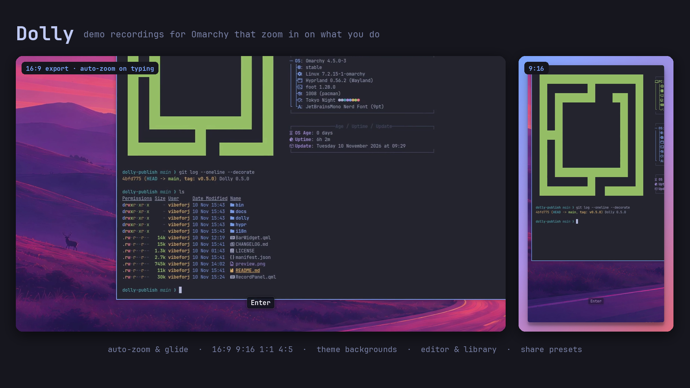
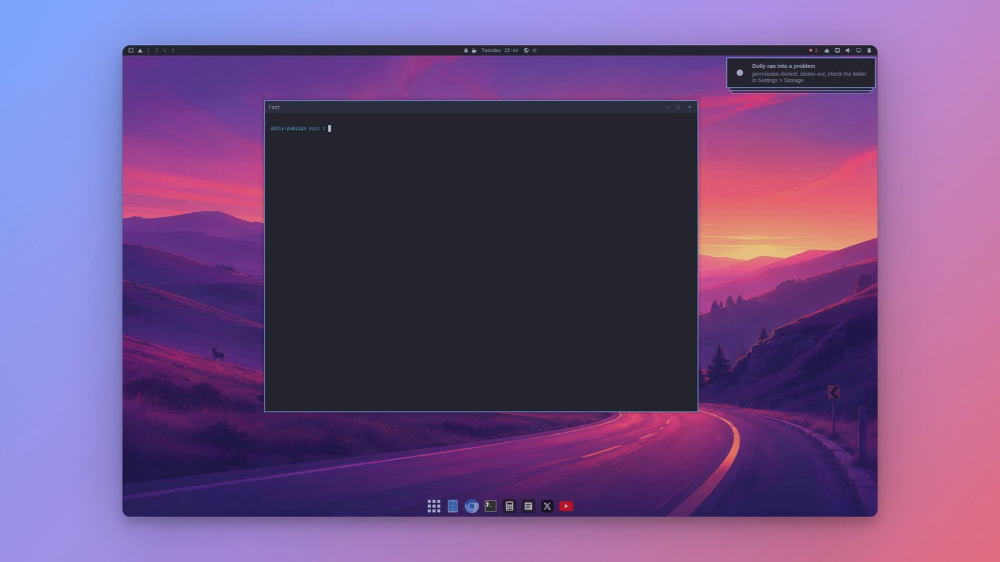
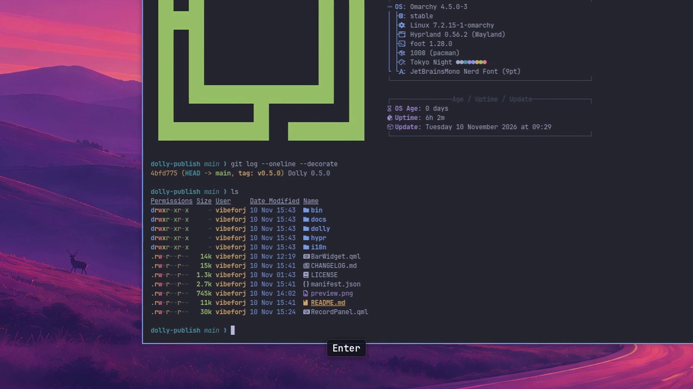
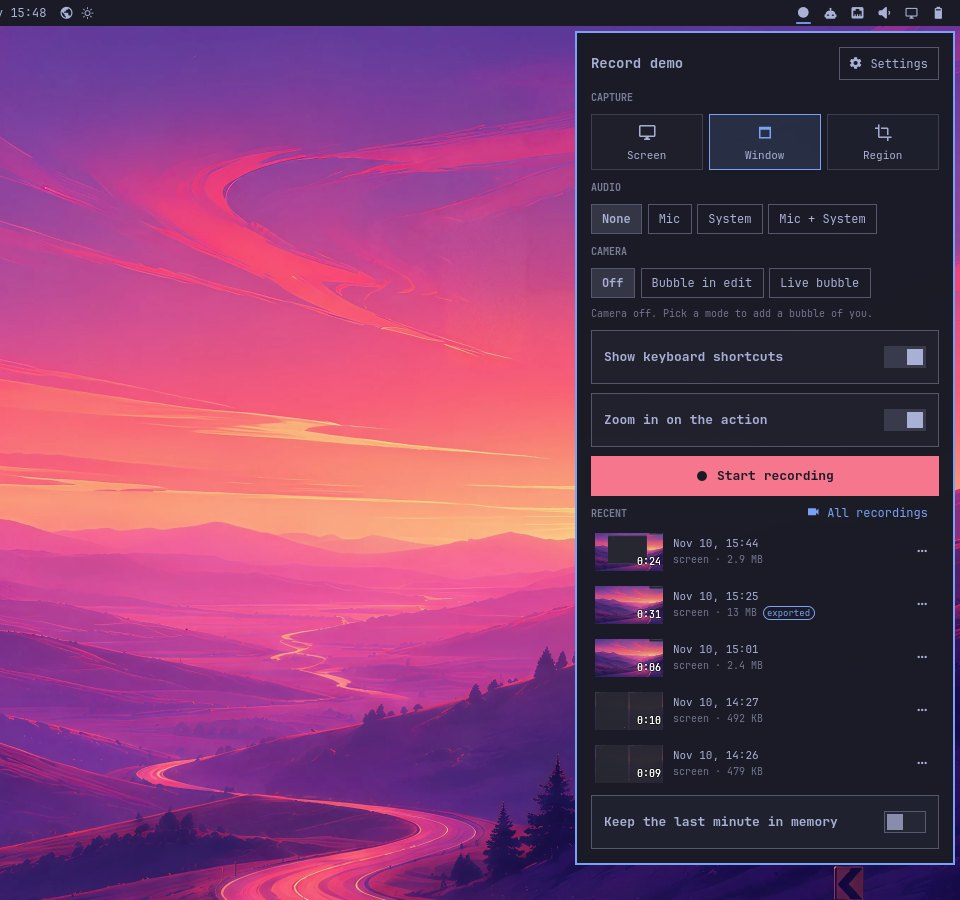
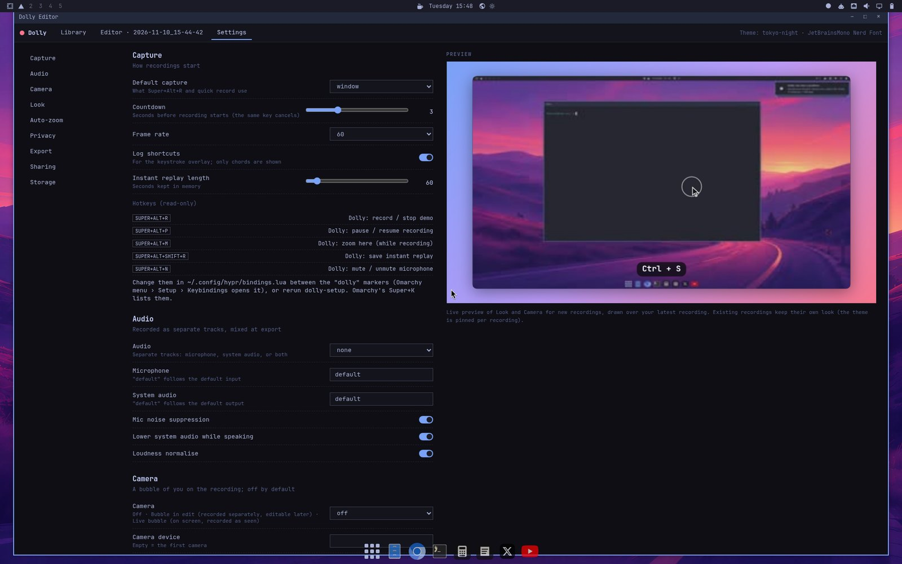
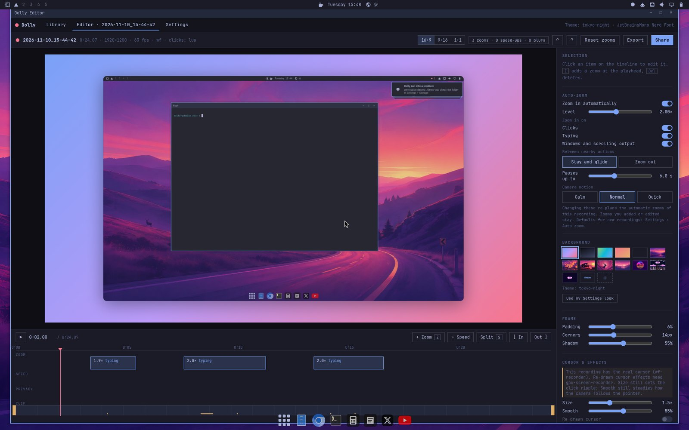
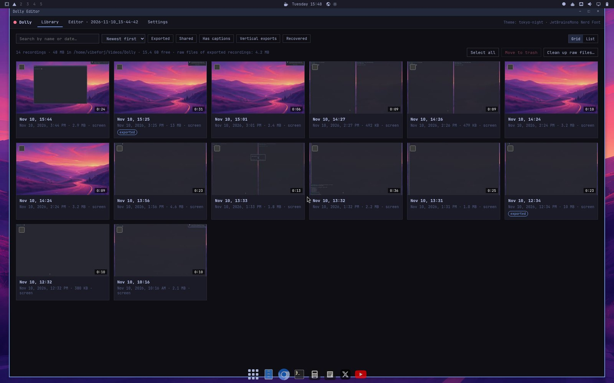
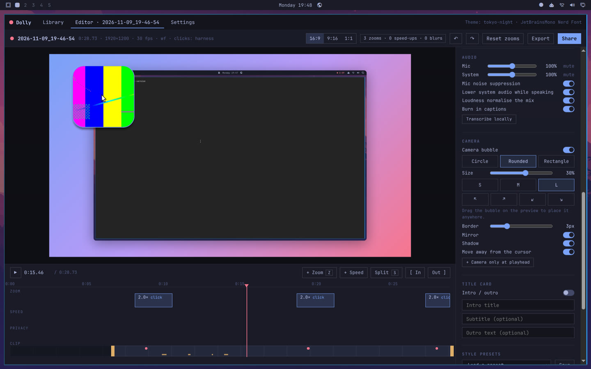
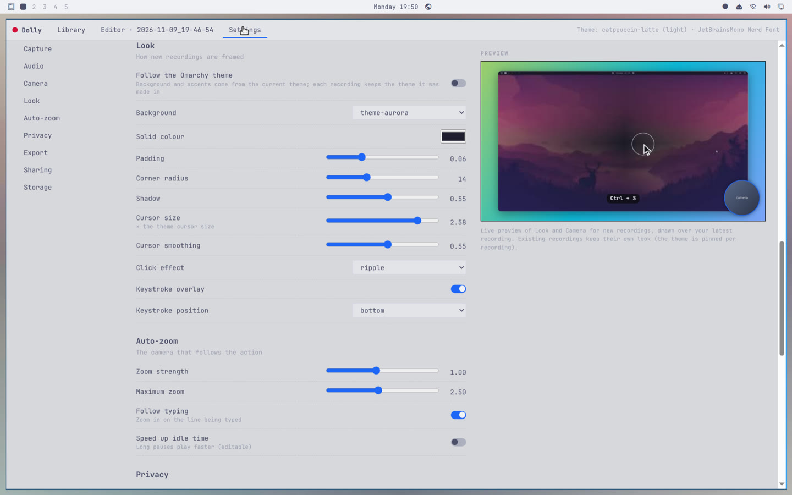

# Dolly: Screen Recorder

A screen recorder for Omarchy that makes polished demo videos and screencasts: the
camera zooms in on what you are doing, then you trim, frame and share from a built-in
editor.



## What it does

Record your screen. Dolly:
- frames what matters, not just the cursor:
  - the command you are typing, even with the mouse parked in a corner
  - the whole window while a log scrolls
  - the dialog a click opened
  - the window you are dragging
  - a clean cut when you switch workspace
- stays zoomed while you work in one place: going down a settings panel or a form,
  the camera glides from one input to the next instead of zooming out and back in
  each time. A long pause, a far jump or a workspace switch zooms out.
- lets you choose how much of this you want (Settings › Auto-zoom, or per recording
  in the editor): automatic zoom on or off, zoom level, which actions zoom (clicks,
  typing, windows and scrolling output), glide or zoom out between nearby actions,
  how long a pause still counts as nearby, and calm/normal/quick camera motion.
  Zooms you add by hand and "zoom here" markers (Super+Alt+M) always apply.
- does the same in vertical 9:16, square 1:1 and 4:5 exports
- redraws a smooth enlarged cursor with click ripples (when the recorder can leave
  the real cursor out; see "Virtual machines")
- puts the recording on a background from your Omarchy theme, with rounded corners
  and a soft shadow (or none of that: see "Background and frame")
- shows keyboard shortcuts
- adds a camera bubble (off by default): edited afterwards, or live on screen
- records microphone and system audio as separate tracks, with noise suppression,
  ducking and a mute-mic key
- speeds through idle moments
- blurs anything that looks like a secret
- keeps a recordings library: search, filters, rename, trash and undo, clean up raw files

Then the share sheet turns it into what each place wants:
- a ≤ 10 MB MP4 for a GitHub PR, or a GIF
- a Discord-sized file
- a vertical 9:16 cut, or a 1:1 square

You can copy the file straight to the clipboard (Ctrl+V into the upload box),
or get a link from your **own** storage (S3, R2, B2, MinIO, or anything rclone
supports). Sharing is local-only until you set a target up.

## Screenshots

Real output, recorded on Omarchy 4.5 in VirtualBox (software rendering).

| Export: framed on a theme background | Export: auto-zoom on the command being typed |
|---|---|
|  |  |
| **Record panel (bar button)** | **Settings, with a live preview of the look** |
|  |  |

| Editor: timeline with automatic zooms, auto-zoom options |
|---|
|  |



From the test harness (headless sway, test-pattern camera, synthetic audio), for
features a VM cannot show:

| Editor: camera bubble and audio tracks | Settings in a light theme |
|---|---|
|  |  |

## Install

From the Omarchy plugin marketplace, or:

```bash
omarchy plugin add https://github.com/jagritvats/omarchy-dolly.git --enable
```

The record button appears on the bar. Open it and click **Set up**: one terminal adds
the hotkeys (Super+Alt+R to record) and Omarchy menu rows and installs the packages
Dolly needs (about 9 MB to download, 55 MB on disk; it asks for your password once). That is the
whole setup. Everything else has a default and can be changed later in Settings.

The same from a terminal:

```bash
~/.config/omarchy/plugins/io.github.jagritvats.dolly/bin/dolly setup   # everything the button does
dolly doctor                                                           # what works on this machine
```

Set up also puts `dolly` on your PATH (a link in `~/.local/bin`), so the commands
below work in any terminal, script or agent shell.

**Updating.** `dolly update` runs Omarchy's own `omarchy plugin update` and then
refreshes what Set up wrote (the menu entry, the hotkeys, the `dolly` command): no
password, no terminal. If you update with Omarchy's command directly, Dolly does the
same refresh by itself. A running Omarchy shell keeps the bar button it has loaded, so
`dolly update` restarts the shell when the button changed (`--no-restart` to skip that);
after Omarchy's own command the new button appears at the next shell start, and a card
offers to restart it.

Needs Omarchy 4.x (the Quattro shell).

**Required packages** (not in Omarchy's base): `python-numpy` and `python-pillow`.
In a virtual machine also `wf-recorder` (gpu-screen-recorder, which ships with
Omarchy, cannot use a virtual GPU). `ffmpeg` ships with Omarchy.

**Optional**: `tesseract` and `tesseract-data-eng` (scrub secrets), `rclone`
(Drive/Dropbox/... links), whisper.cpp or faster-whisper (captions), a camera, `mpv`
(camera preview and live bubble).

## Use

| | |
|---|---|
| Bar button | click: the Dolly panel (capture mode, audio, camera, Start, recent recordings, **Settings**) · right-click: quick record · while recording: click stops, right-click shows pause / mute mic / stop / discard · Omarchy's `Super+Ctrl+<n>` opens the panel by its place in the bar's right section. The button watches Dolly's state files; nothing runs in the background while you are not recording |
| Hotkeys (after **Set up**) | Super+Alt+R record/stop · Super+Alt+P pause · Super+Alt+N mute mic · Super+Alt+M zoom here · Super+Alt+Shift+R save last 30 s (instant replay) · Super+Alt+L recordings (Omarchy 4.5 uses it, so it is skipped there). Change any of them, or switch one off, in **Settings › Shortcuts** (or `dolly config set shortcuts.toggle="SUPER + CTRL + D"`; empty = off); only Dolly's own marked block in `~/.config/hypr/bindings.lua` is rewritten. A combination that is already bound is never taken; if an Omarchy update later claims one, the panel says so and **Fix** gives those keys up. Omarchy's Super+K lists them |
| Menu (Super+Space, after **Set up**) | Trigger → Capture → **Demo**: record a window, a region or the screen · open last · recordings · share last recording · instant replay · settings. While a take is running the entry is **Stop demo** |
| Editor | opens after you stop, without taking focus. Library · Editor · Settings. Timeline lanes for zoom, speed and privacy; 16:9 / 9:16 / 1:1 preview; In/Out trim; camera bubble shape, size and position (drag it); camera-only ranges; per-track volume and mute; blur boxes; Scrub secrets; captions; title card; **Share** (Ctrl+E) |
| Settings | the editor's Settings view (also `dolly settings`): Capture, Audio, Camera, Look, Auto-zoom, Privacy, Export, Sharing, Storage. Stored in `~/.config/dolly/config.json`; the bar widget's own options stay in sync |
| CLI | `dolly record [--mode screen|window|region] [--audio none|mic|system|both] [--camera off|edit|live] · stop · pause · mute · mark · replay · edit · library [--open] · settings · config get/set · export [--aspect 16:9|9:16|1:1|4:5] [--quality draft|fast|high|best] [--gif] · share … · run demo.toml [--dry-run] [--json] [--stage] · stage start|stop|status|shot|exec|type|key|click|move (beta) · recover · deps · setup · update · integration · doctor` |

### Scripted demos

Write the demo as steps; Dolly performs it, records it and exports it. The same
file gives the same take every time, so re-recording after a change is one command.

```toml
# demo.toml
title  = "Listing files"
aspect = ["16:9", "9:16"]

[[setup]]              # before recording
open = "terminal"
as   = "term"

[[step]]
type  = "ls -la"       # typed with a human rhythm
enter = true

[[step]]
wait = "quiet"         # until the screen stops changing

[[cleanup]]
close = "term"
```

```sh
dolly run demo.toml --dry-run   # the timed plan; touches nothing
dolly run demo.toml             # prints the exported files
```

Steps: `open`, `focus`, `type`, `key`, `wait`, `move`, `click`, `zoom`, `say`
(a caption), `close`. Everything it needs ships with Omarchy. A storyboard runs commands and types with your
permissions, so read one before you run it, like a shell script. Reference:
[docs/storyboard.md](docs/storyboard.md) · a longer example:
[examples/terminal-demo.toml](examples/terminal-demo.toml).

### Plain recording, no zoom

Turn off **Zoom in on the action** in the panel before recording, or make it the
default with `dolly config set zoom.enabled=false`. For a recording you already
made, switch off **Zoom in automatically** in the editor (or press **Reset
zooms**). Pick **Screen** for the whole monitor.

### Background and frame

- Presets: `theme-glow` (default), `theme-dusk`, `theme-aurora`, `theme-ember`,
  `theme-ink` (all from your Omarchy theme colours), `solid`, `wallpaper`.
  Choose one in the editor's Background panel, or set the default with
  `dolly config set look.background=theme-ember`.
- Frame: `look.padding` (0–0.2), `look.radius` (0–40 px), `look.shadow` (0–1),
  `look.background_color` for `solid`. Padding 0, radius 0 and shadow 0 give a
  plain full-bleed video with no background.
- Your own image: **Add image…** in the editor's Background panel picks one from your
  theme's backgrounds, `~/Pictures`, a file dialog or a path (PNG, JPEG or WebP),
  with optional blur. Settings › Look makes it the default for new recordings
  (`look.background=image`, `look.background_image`, `look.background_blur`).
  A custom gradient can be set in a recording's `project.json` with
  `"style": {"background": {"stops": [...], "angle": 135}}`.
- Aspect: 16:9, 9:16, 1:1 (editor and export) and 4:5 (`dolly export --aspect 4:5`).
  Vertical and square exports follow the action. There is no crop of the recorded
  area after recording; use **Region** to record part of the screen.

Recordings go to Omarchy's screen-recording folder (`$OMARCHY_SCREENRECORD_DIR`,
else your Videos folder) under `Dolly/`, unless you pick a folder in Settings ›
Storage. Dolly estimates how many minutes of recording the disk holds, warns when
it is getting short and only refuses with a couple of minutes left (with
**Record anyway**, **Choose folder** and **Clean up** buttons).

Sharing is **local-only by default**. Nothing uploads until you add a target with
`dolly share init` (a 0600 config; credentials come from env, an AWS profile or
rclone, never bundled).

While recording, Dolly:
- turns Do Not Disturb on
- keeps windows solid if you use Omarchy's Glassy look
- puts both back afterwards

It never runs a second recorder next to Omarchy's own: it refuses to start while
Omarchy's recorder runs, and Omarchy's screen-recording key stops a Dolly
recording like Dolly's own key would (saved, editor opens). It stops cleanly
(keeping everything recorded) on suspend, lock, low disk, a crashed recorder or
an unplugged monitor. After a hard crash, `dolly recover` saves the partial
recording.

## For agents and scripts

Dolly can be driven without a keyboard or a click, for example by a coding agent that
wants to show what it just built. Nothing asks a question.

```bash
# record a named window for 12 seconds; no click, no countdown, no editor
dolly record --window kitty --for 12 --json
# {"ok": true, "recording": false, "dir": "/home/me/Videos/Dolly/2026-11-10_21-24-56",
#  "raw": ".../raw.mkv", "duration": 12.4, "trim": [0.0, 12.4], "zooms": 2, "blurs": 0, ...}

# or: start, run the thing you want to show, stop
dolly record --window class:chromium --json      # returns once it is recording
./run-my-demo.sh
dolly stop --json                                # the same object as above

# export; "dir" comes from the object above (no dir: the latest recording)
dolly export "$DIR" --json --width 1280
# {"ok": true, "output": ".../2026-11-10_21-24-56.mp4", "bytes": 1070286, "duration": 12.6,
#  "width": 1280, "height": 720, "aspect": "16:9", "format": "mp4"}
```

- Target: `--window SELECTOR` (a class, part of a title, `class:NAME`, `title:TEXT`,
  `address:0x...` or `active`; of several matches the most recently focused wins),
  `--monitor NAME`, or `--region X,Y,WxH` in logical pixels.
- `--for SECONDS` stops and finalizes by itself; `--wait` blocks until someone else stops
  it; with neither, `record` returns as soon as recording has started.
- `--json` prints exactly one JSON object on stdout and never opens the editor
  (`--no-editor` does only the latter).
- It works from a shell with no session variables (ssh, a systemd unit, an agent's tool
  call), as the logged-in user: the Hyprland session is found by itself.
- Errors are the same shape with exit code 1:
  `{"ok": false, "error": "window-not-found", "message": "...", "windows": [...]}`.
  Codes: `window-not-found`, `monitor-not-found`, `bad-region`, `needs-target`,
  `already-recording`, `other-recorder`, `not-recording`, `missing-packages`,
  `folder-not-writable`, `disk-full`, `no-compositor`, `export-failed`.
- Automatic zooms, cursor smoothing and the automatic privacy blurs apply as in a normal
  recording; `dolly edit DIR` opens it in the editor later.

## Hidden stage (beta)

A second, invisible desktop that Dolly can record on while you keep working. The stage
has its own pointer, its own keyboard focus and its own windows; nothing of it shows on
your screen, and nothing you do reaches it.

```bash
dolly run demo.toml --stage                   # perform and record a storyboard on the stage
dolly run demo.toml --stage --stage-size 1080x1920    # a vertical stage for 9:16 demos
dolly record --stage --for 20 --json          # record the stage for 20 seconds

dolly stage start [--size 1920x1080] [--background wallpaper|colour]
dolly stage exec -- chromium https://example.com      # start a program on it
dolly stage type 'ls -la' --enter             # type into its focused window
dolly stage key ctrl+l                        # a key or a chord
dolly stage click 640 360                     # move its pointer there and click
dolly stage move 200 120
dolly stage shot stage.png                    # look at what is on it
dolly stage status
dolly stage stop
```

`--stage` starts a stage when none is running and stops it afterwards. A stage you
started with `dolly stage start` stays until `dolly stage stop`. Every `dolly stage`
command takes `--json`.

What a stage take leaves alone: your windows, pointer and focus, the bar button (it only
shows recordings of your desktop), notifications (no cards are sent for a stage take),
Do Not Disturb, Stay Awake and key repeat. You can record your own desktop while a stage
take runs, and the reverse.

What it is: a second Hyprland started inside your session, with the look of your Omarchy
(gaps, borders, colours, fonts, input settings) and your desktop picture, but no bar and
no dock; its only screen is one that exists on no monitor. It runs under a memory limit
(1500 MB) and stops by itself after 30 minutes; both are settings (Settings > Hidden
stage).

**Driving a stage by hand.** An agent that records with `dolly record --stage` and types
by itself should type with `dolly stage type` and `dolly stage key`, and click with
`dolly stage click`, not with `wtype`. They type and click on the stage and tell the
take what they did, by name, so the take shows the right keycaps and follows the typing.
A typing tool brings a keymap of its own and Hyprland reports its keys as codes that say
nothing about the key (the letters of "ls" arrive as "Escape" and "1"). A key typed with
another tool is therefore logged as a key without a name: the typing is still followed,
and no wrong key is ever shown.

**The background** is your current Omarchy desktop picture, cut to fill the stage
(1080x1920 too). It is drawn once by Quickshell, which ships with Omarchy; no package is
added. When the picture cannot be found or drawn, the stage shows your theme's colour and
`dolly stage start` says why. Settings > Hidden stage > Behind the windows chooses the
picture or the colour; `--background` chooses for one stage.

**Sound, microphone, camera.** Programs on the stage play into a private output, not
your speakers. `--audio system` on a stage take records that output: what the stage's
programs play, and nothing of what your desktop plays. The microphone and the camera are
your own, in the room. A stage take records neither unless the command asks
(`--audio mic`, `--audio both`, `--camera edit|live`), whatever Settings say for your own
recordings; asked for, the microphone track is your real default microphone and the
camera is your real camera.

**Is it working here?** `dolly doctor --stage` uses a stage the way a take does and says,
step by step, what worked: start, a drawn frame, a second of recording, the sync mark in
that recording, where the stage's sound goes, stop. `dolly doctor --report` puts the same
into the file for a bug report.

This is a beta. **It has only ever been run in a VirtualBox VM** (software rendering, no
GPU, no camera). If you have a machine with a real GPU, `docs/stage-testing.md` is a
ten-minute checklist of what to run and what to send back. Known limits:

- It is recorded with `wf-recorder` (CPU encoding, about half of one CPU core in the VM
  at 1080p60), and the pointer is part of the picture.
- The desktop picture costs one small program for as long as the stage runs: no CPU
  while nothing changes, and memory for one picture. A video background shows its first
  frame.
- Browsers started on the stage get a profile folder of their own
  (`~/.cache/dolly/stage-profiles`), otherwise the window would open in your running
  browser. Other programs that keep a single running copy may still open on your desktop.
- A program that names its own sound output plays there, not on the stage's.
- Timing comes from the stage's pointer: it is shown in the top-left corner for a moment
  at the start of a take, and again at the end, where it stays until the recorder has
  stopped (both outside the exported range).
- Stopping a stage take waits for its recorder. wf-recorder drops the frames it has not
  encoded yet when it is told to stop, so the stage is left still until the recorder has
  finished them: a second or two in the VM. It also writes 60 frames for every second in
  which nothing changed, and only when the next change comes; in the VM that takes about
  as long as the still stretch itself, so stopping a take on a stage where nothing moved
  for ten seconds takes ten seconds more (`--fps 30` halves it). A machine that encodes
  video quickly should not notice; nobody has measured one yet.
- On a machine that is far too busy the recorder falls behind for good (seen once, with
  three compilers on the VM's four cores): the end of the take, with its stop mark, never
  reaches the file. The take's result then warns that only one of the two sync marks was
  found.
- On a stage nothing is resized by dragging a window's border (the resize pointer would
  spoil the sync mark).
- X11 programs do not run on a stage. One stage at a time. What happens to a stage when
  your session locks or sleeps is not known yet.

## Virtual machines

Tested on Omarchy 4.5 in VirtualBox 7.2 (VMSVGA, 3D on).
- Install `wf-recorder`: gpu-screen-recorder does not support virtual GPUs
  ("unknown gpu vendor"). `dolly doctor` says which recorder it will use.
- wf-recorder records the real cursor, so the redrawn cursor and motion blur are
  off for those recordings (the editor greys them out and says why); cursor size
  still sizes click ripples and Smooth still steadies the camera. Pause and instant
  replay need gpu-screen-recorder.
- The cursor you see moving smoothly in the VM window is VirtualBox's own pointer,
  not Dolly.
- If Omarchy's shell (bar, launcher) crash-loops on a VirtualBox/VMware display,
  add `export QT_QUICK_BACKEND=software` to `~/.config/uwsm/env` and log in again.
- `/tmp` is in memory on Omarchy; keep recordings on disk (the default).

## Uninstall

```bash
~/.config/omarchy/plugins/io.github.jagritvats.dolly/bin/dolly cancel             # if a recording is running
~/.config/omarchy/plugins/io.github.jagritvats.dolly/bin/dolly replay stop        # if instant replay is on
~/.config/omarchy/plugins/io.github.jagritvats.dolly/bin/dolly-setup --undo       # menu rows, hotkeys, camera window rule, the dolly command
omarchy plugin remove io.github.jagritvats.dolly --yes
rm -rf ~/.local/share/dolly ~/.cache/dolly ~/.local/state/dolly    # optional: venv, caches, state
```

If you remove the plugin without `--undo`, its hotkeys and menu rows switch
themselves off (they only load while the plugin is installed); `--undo` also
deletes the lines.

Your recordings (`…/Videos/Dolly`) and `~/.config/dolly/` (settings, and
`share.json` with any credentials you added) are kept; delete them yourself if
you want them gone. Packages installed for Dolly stay installed; remove them with
`sudo pacman -Rs` if nothing else uses them.

## Troubleshooting

- `dolly doctor` checks the recorder, packages, disk, hotkeys and the bar widget,
  and says what to do about anything missing.
- `dolly doctor --report` writes one text file to attach to a bug report: checks,
  versions, settings and logs. No video, no screenshots, no typed keys.
- Errors show one line (and a notification when started from the bar or a hotkey);
  the full details go to `~/.local/state/dolly/last-error.log`, a running log to
  `~/.local/state/dolly/dolly.log`. Please attach both to a bug report.
- A recording's files are written safely: if one is damaged (power loss), Dolly
  restores the previous version and keeps the broken copy as `*.damaged`.

## Developers

Everything is in this repository:
- `make test`: the test suite (Python, pytest; ~6 minutes). It never touches your
  desktop: notifications, Hyprland and the bar are stubbed.
- `make scenarios` / `make demo`: the synthetic-desktop harness (`harness/`) that
  checks the camera on generated recordings.
- `TESTING.md` and `AGENTS.md`: the real-hardware test plan (also written so an
  AI coding agent can run it).
- `CHANGELOG.md`: what changed in each version.

Bugs and ideas: <https://github.com/jagritvats/omarchy-dolly/issues> (please attach
`dolly doctor` output and `~/.local/state/dolly/last-error.log`).

## License

MIT, see [LICENSE](LICENSE).
